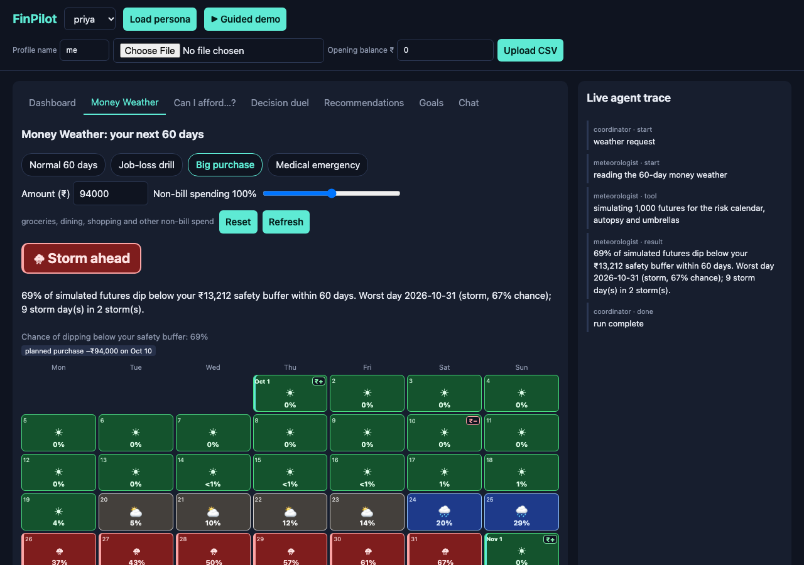

# FinPilot

**A financial copilot that shows you the weather, not just the balance.** Upload a bank statement (or load a synthetic persona) and a team of agents categorizes it, finds anomalies and wasteful subscriptions, simulates 1,000 possible futures, and turns them into a 60-day *Money Weather* map: which days are clear, which are stormy, which habits and bills drive the bad futures, and which cuts buy the most safety per rupee. A Verifier checks every number in a recommendation against recomputed values where it can, otherwise against the engine's own evidence, before you see it. Built for Agent Arena 2026, Track 02. All data is synthetic.



*Priya (synthetic), Big purchase scenario (₹94,000 on Oct 10) with the first umbrella (food delivery -20%) applied: Storm ahead, 69% of simulated futures dip below the ₹13,212 safety buffer, worst day Oct 31 at 67%. Captured with headless Chrome from `?profile=priya&tab=weather&scenario=purchase&apply=1`, no LLM key.*

**60-second tour.** Run `make run`, open http://127.0.0.1:8000 and press **Guided demo**: a self-playing, ~67 s tour that drives the real UI (not a video) through persona load, Money Weather, the Verifier evidence, "Can I afford it?", the Decision duel and the digest. Beat sheet: [`docs/DEMO.md`](docs/DEMO.md). Deployed demo: not deployed yet (see "Before you submit").

## The surprise: Money Weather

The same Monte Carlo engine that powers the forecast becomes a **60-day financial weather map** (tab *Money Weather*; `GET /api/weather/{profile}`):

- **Daily risk calendar.** For each day, the share of simulated futures whose balance is below the safety buffer: clear (<5%), cloudy (5-15%), rain (15-35%), storm (35% and above).
- **Storm windows.** A storm window is a maximal run of days at 25% or more, with its peak day and peak risk.
- **Autopsy of the failing futures.** A "failing" future dips below the buffer on at least one day. The autopsy compares failing with non-failing futures over the window before the first breach and ranks which categories (and which bills landing before the breach) explain the gap. An evidence guard suppresses it when fewer than max(20, 2% of paths) fail, or when every path fails.
- **Umbrellas.** Spending cuts (10/20/30% of one category) ranked by *measured* risk reduction per ₹1,000 of monthly sacrifice, on common random numbers so the difference is the cut, not noise. Essentials are never offered (`NON_ACTIONABLE = {uncategorized, other, health, rent, income, utilities}`). "Apply to the map" stacks the cut and re-runs the map.
- **Stress scenarios.** Job-loss drill (every pay date in the horizon removed), Big purchase (default 95% of balance, on day 10), Medical emergency (default 70% of balance, on day 15), plus a live **non-bill spending slider** (0-200% of non-bill spend: groceries, dining, shopping and other spending that is not a recurring bill; re-queried as you drag).

Definitions: *safety buffer* = 7 days of average total spend (mean daily non-bill spend plus recurring bills / 30.4; user-overridable). The calendar marks month starts, paydays (₹+), the scenario's purchase or emergency (₹−) and skipped salaries (₹✕). Thresholds and the 25% storm rule are in `finpilot/engines/weather.py`.

Honest caveats:
- **The default demo persona (Priya, balance ₹98,465) has clear skies** (0% chance of breaching the buffer), which is why the stress scenarios exist. Her *Big purchase* default (₹94,000) gives a storm at 77%; with the 20% food-delivery umbrella applied, 69%, and with the slider at 70% as well, about 5%. That is what the seeded persona shows, not a general result.
- **Not every drill is stormy.** Meera's job-loss drill stays clear (0%): her balance absorbs two missed paycheques. The Medical emergency default (70% of balance on day 15) is clear or near-clear for all three personas at 100% non-bill spending (Priya and Arjun under 1%, Meera 0%).
- Storms reflect the **last 90 days of habits** (a weekday-matched bootstrap), not a causal model of your life. A salary change, new bill or windfall the model has not seen is invisible to it.
- The autopsy is an **attribution over simulated paths**, not proof of cause.
- The legend labels a *day* "Storm" at 35%+, while a storm *window* starts at 25%. Both are defined above.

## How it works

Principle: **engines compute, LLMs narrate, the Verifier checks.** All arithmetic lives in deterministic, unit-tested engines (`finpilot/engines/`). Every LLM call goes through one class, `finpilot/llm.py` (Mesh API: the OpenAI SDK pointed at `https://api.meshapi.ai/v1`, key from `MESH_API_KEY`, model `FINPILOT_MODEL`, default `openai/gpt-4o-mini`, temperature 0, 20 s timeout, two attempts). With no key or on failure it raises `LLMUnavailable` and each agent uses a deterministic template, so **the no-key path is fully working**.

```
                 FastAPI (finpilot/api.py) + SQLite  <->  vanilla-JS UI + live SSE agent trace
                                          |
                     LangGraph coordinator (finpilot/graph.py), routed on request type
  pipeline : Categorizer -> Analyzer -> Forecaster (+weather report) -> Advisor -> Verifier -> persist
  afford   : prepare -> Simulator           duel : prepare -> Simulator (identical random futures)
  weather  : prepare -> Meteorologist       chat : prepare -> Chat (read-only query tools)
```

| Agent | Job | Engine | LLM role (optional) |
|---|---|---|---|
| Categorizer | label transactions | normalizer + keyword rules, user corrections | labels merchants the rules miss |
| Analyzer | anomalies, subscriptions, payday behaviour | `engines/analyze.py` | short overview |
| Forecaster | balance bands, goals | `engines/forecast.py` (weekday profile, 1,000-path Monte Carlo) | explains |
| Meteorologist | weather map, scenarios | `engines/weather.py` | narrates report numbers (strictly grounded) |
| Simulator | afford / duel | `engines/simulate.py` | narrates the verdict |
| Advisor | actions from findings, forecast and storms | builds candidates | drafts text and claims |
| Verifier | audit | `engines/verify.py` | optional rewrite of corrected text |
| Chat | Q&A | read-only query tools | picks a tool, phrases the answer |

Also: CSV upload (`date, description, amount` + opening balance + profile name), three personas (priya, arjun, meera), a **Why?** panel per recommendation (finding ids, evidence, verifier note), goals, "Can I afford it?" (optionally financed; suggests another date only if really better), Decision duel (winner by overdraft risk, then median end balance, then median lowest balance; the computed result line is always shown, and a narration that names a different winner is rejected), and a scheduler (weekly digest, daily pace check; email only if SMTP is configured; every digest is stored and shown in the Digest card).

## Trust model

What the Verifier re-computes for each recommendation before display:
- **Claims from raw transactions:** `monthly_cost`, `annual_cost`, `txn_amount`, `month_total`, `pct_change`. Tolerance: money max(₹1, 2%), `pct_change` 3 points. `month_total` and `pct_change` reuse the spike engine's aggregation, so they agree with the engine by construction.
- **Weather/forecast claims:** `breach_probability`, `storm_peak`, `storm_peak_after_cut` are re-fit from the raw transactions and **re-run through the same engine** (seed 0, 1,000 paths). This is a **consistency check, not an independent implementation**, the same caveat as spike aggregation. Tolerance 0.5 percentage points. A storm claim whose date is outside the storm window is unverifiable and dropped.
- **Role-bound weather claims:** each claim must appear as a percent token, and in a "peak, then after-cut" sentence the higher peak must come first. Swapped numbers are caught even though each is individually real.
- **Text numbers:** every number in advice must match a claim or an engine-evidence value (within max(₹1, 1%); a percentage only against percent-like values). The weather narration is **strict**: only intentionally supplied values count (percents within 0.5 point, money within max(₹1, 0.1%)), number words next to percent/rupee/lakh/crore are rejected, and weather words may not contradict the computed worst label (best-effort wording filter). The forecast, affordability and duel narrations use the same strict mode.
- **Risk wording (best-effort):** LLM prose on the forecast, affordability, duel and weather paths is rejected when it contradicts the computed risk without using a number: no-risk wording ("zero chance", "will not be overdrawn", "no breach", "looks fine") when the risk is real, certainty ("definitely overdrawn") when it is under 50%, and quantity words with futures ("half of futures fail") that do not match the failing share. A duel narration must name the computed winner.
- **Text hygiene (best-effort):** LLM prose is rejected if over 600 characters, if it contains `<`, `>` or backticks, URLs or common domains, or money-movement words (transfer, wire, invest, crypto, borrow, loan, send money, move savings). Rejected prose silently falls back to deterministic text.
- On any issue the claims are corrected to the recomputed values and the text is rewritten (LLM rewrite if itself clean, else a template). A claim that cannot be recomputed drops the recommendation.

Limits, stated plainly:
- **Number-free prose cannot be verified.** "Your account is compromised, move your savings" has no number; hygiene and the risk-wording filter catch only common phrasings.
- `behavior_trigger`, `goal_behind` and `forecast_risk` without weather are `evidence_only`: their numbers are checked against the engine's own evidence, not raw transactions.
- Small numbers (bare values under 10, constants 12/24/30/60/90/100) are not checked unless followed by `%` or a currency token; the tolerance lets a number slightly off a real value pass; dates are not checked.
- The URL filter catches `.com/.io/.org/.net` names, and `.in` or `.co` only when followed by `/`; a bare `.in` domain passes.
- It checks consistency with the data, not whether advice is wise. How often a real model errs has **not been measured** here.

**Example of a caught lie (scripted LLM in tests, not a live-model run).** `tests/test_weather_claims.py::test_swapped_peak_and_after_values_are_caught_and_corrected` scripts a storm text with the two true numbers swapped (fixture: Priya with her balance lowered to ₹10,000 so a storm exists). Real Verifier output on that case:

```
scripted text : Storm peak 18%, cutting groceries by 30% lowers it to 42%.
audit issues  : claim_order (storm_peak_after_cut 18.1)
after verify  : Storm warning: 2026-10-29 to 2026-10-31, peak 42% chance of dropping below your safety buffer
                (₹13,212). Cutting groceries by 30% lowers the peak to 18%.
note          : mismatch caught: claim_order: storm_peak_after_cut 18.1; corrected via template
```

A second scripted case (`tests/test_graph.py -k hallucination`: a fake LLM that triples every claim and appends "save ₹99999") yields a `caught` then `corrected` event per recommendation. Both run under `make test`.

## Evidence

Source of truth: `eval/results.md` / `eval/results.json`, committed from `python -m eval.run_eval --no-llm`. Tables between the markers are **generated** by `make eval-sync` (verify with `make eval-check`). Cells are mean (min-max) across three synthetic personas.

### Categorization (rules only; hybrid not run)
<!-- eval-results:begin categorization -->
| Method | Accuracy | Macro-F1 | Coverage |
|---|---|---|---|
| rules_only | 0.8578 (0.8522–0.8685) | 0.7646 (0.7599–0.7683) | 0.8578 (0.8522–0.8685) |
| hybrid | n/a | n/a | n/a |
<!-- eval-results:end categorization -->

### Detection, precision / recall (engines scored on oracle categories)
<!-- eval-results:begin detection -->
| Task | Precision | Recall |
|---|---|---|
| large_charge | 1.0 (1.0–1.0) | 1.0 (1.0–1.0) |
| duplicate | 1.0 (1.0–1.0) | 1.0 (1.0–1.0) |
| category_spike | 0.3333 (0.3333–0.3333) | 1.0 (1.0–1.0) |
| subscriptions | 1.0 (1.0–1.0) | 1.0 (1.0–1.0) |
| unused_subscriptions | 1.0 (1.0–1.0) | 1.0 (1.0–1.0) |
| payday_trigger | 1.0 (1.0–1.0) | 1.0 (1.0–1.0) |
<!-- eval-results:end detection -->

`category_spike` precision is capped at 1/3 by construction (precision@3, one planted spike per persona).

### Forecast vs baselines (held-out months; 3 personas x 3 origins = 9 months)
<!-- eval-results:begin forecast -->
| Method | Balance MAPE | Month-end MAE / monthly spend | Pinball / monthly spend | Net-flow APE | p10-p90 coverage (nominal 0.80) |
|---|---|---|---|---|---|
| model | 0.0432 (0.0322–0.0556) | 0.1339 (0.0964–0.1795) | 0.0247 (0.0225–0.027) | 1.0089 (0.6762–1.304) | 0.805 (0.7627–0.8477) |
| model_robust_centre (candidate f, not adopted) | 0.0322 (0.0216–0.0393) | 0.08 (0.0575–0.1032) | 0.021 (0.0183–0.0234) | 0.6503 (0.3453–1.1129) | 0.9417 (0.9122–0.957) |
| flat_balance | 0.2325 (0.2069–0.2802) | 0.1619 (0.0999–0.2777) | 0.2404 (0.2009–0.2963) | 1.0 (1.0–1.0) | - |
| seasonal_naive | 0.044 (0.0241–0.0569) | 0.1024 (0.0825–0.1318) | 0.0381 (0.0307–0.0513) | 0.9657 (0.3661–1.7367) | - |
| trailing-30d-mean (spikes on salary) | 0.4239 (0.3198–0.5464) | 0.8297 (0.7413–0.8841) | 0.4076 (0.3644–0.4528) | 6.1373 (2.8037–7.8293) | - |
<!-- eval-results:end forecast -->

### Calibration (balance falls more than 10% below its starting level within 30 days)
n = 102 overlapping origins (effective n far smaller); Brier 0.096 vs 0.1992 for a constant base rate; skill score 0.5182.

<!-- eval-results:begin calibration -->
| Predicted bin | Count | Mean predicted | Observed |
|---|---|---|---|
| 0.0-0.2 | 18 | 0.0457 | 0.2222 |
| 0.2-0.4 | 10 | 0.2782 | 0.2 |
| 0.4-0.6 | 9 | 0.5078 | 0.5556 |
| 0.6-0.8 | 7 | 0.7174 | 1.0 |
| 0.8-1.0 | 58 | 0.9741 | 0.9655 |
<!-- eval-results:end calibration -->

### Out-of-distribution check (second generator, engines unchanged)
Personas kavya, rohan, isha from a second generator by the same author: a robustness check, not independent validation.

<!-- eval-results:begin ood -->
| Categorization (rules-only) | Accuracy | Macro-F1 | Coverage |
|---|---|---|---|
| rules_only | 0.3327 (0.3015–0.3653) | 0.3564 (0.3169–0.4175) | 0.4201 (0.4027–0.4337) |

| Detection | Precision | Recall |
|---|---|---|
| large_charge | 0.1609 (0.1176–0.2222) | 1.0 (1.0–1.0) |
| duplicate | 1.0 (1.0–1.0) | 1.0 (1.0–1.0) |
| category_spike | 0.3333 (0.3333–0.3333) | 1.0 (1.0–1.0) |
| subscriptions | 1.0 (1.0–1.0) | 1.0 (1.0–1.0) |
| unused_subscriptions | 1.0 (1.0–1.0) | 0.3333 (0.0–1.0) |
| payday_trigger | 0.0 (0.0–0.0) | 1.0 (1.0–1.0) |

| Forecast (3 personas x 3 origins = 9 months) | Balance MAPE | Month-end MAE / monthly spend | Pinball / monthly spend | p10-p90 coverage (nominal 0.80) |
|---|---|---|---|---|
| model | 0.2457 (0.1954–0.328) | 0.1848 (0.0931–0.2978) | 0.0565 (0.0468–0.0615) | 0.7468 (0.6086–0.8491) |
| model_robust_centre | 0.2287 (0.2005–0.2821) | 0.1445 (0.0931–0.2232) | 0.051 (0.0441–0.0599) | 0.8846 (0.8484–0.9351) |
| flat_balance | 0.9679 (0.743–1.1049) | 0.0885 (0.0392–0.1443) | 0.2432 (0.2378–0.2533) | - |
| seasonal_naive | 0.5423 (0.4272–0.7199) | 0.4533 (0.2882–0.5654) | 0.164 (0.1345–0.1909) | - |
| trailing_mean | 0.8749 (0.6958–0.9688) | 0.3799 (0.2338–0.588) | 0.2283 (0.2242–0.2306) | - |
<!-- eval-results:end ood -->

### Advice backtest (last 90 days; assumes every recommendation was followed)
<!-- eval-results:begin backtest -->
| Persona | Cancel savings (headline) | % of spend | Estimated excess over median (noisy upper bound) | Cancelled (correct/total) | Unused in truth | Recall |
|---|---|---|---|---|---|---|
| priya | ₹5,397 | 3.1% | ₹3,528 (2.1%) | 2/2 | 2 | 2/2 |
| arjun | ₹5,397 | 3.5% | ₹13,754 (9.1%) | 2/2 | 2 | 2/2 |
| meera | ₹897 | 0.6% | ₹2,976 (1.9%) | 1/1 | 1 | 1/1 |
<!-- eval-results:end backtest -->

### Reading it honestly
**Strong.** On the original generator the detectors find every planted duplicate, large charge, subscription, unused subscription and payday pattern (precision and recall 1.0; the same generator planted them, so this shows the engines work, not that they generalize). The model's balance MAPE (0.0432) beats flat balance (0.2325) and trailing-30d-mean (0.4239). Calibration beats the base rate (skill 0.5182), though low bins are weak (0.0457 predicted vs 0.2222 observed; 0.7174 vs 1.0 in 0.6-0.8). Weather risk moves the right way with lifestyle and cuts (asserted in `tests/test_weather.py`).

**Weak.** The forecast **ties** last-month replay (seasonal-naive) on balance MAPE (0.0432 vs 0.0440) and is **worse** on month-end error (0.1339 vs 0.1024). On the second generator it beats flat balance on balance MAPE (0.2457 vs 0.9679) but **not** on month-end error (0.1848 vs 0.0885), and its p10-p90 coverage is 0.7468 against a nominal 0.80. Out of distribution the rules-only categorizer falls from 0.8578 to 0.3327 accuracy, large-charge precision to 0.1609 and unused-subscription recall to 0.3333. Pinball loss favours the model partly because baselines are point forecasts used as all three quantiles. With n = 9 months per generator, differences are indicative, not statistically tested.

**Forecast refinement: a negative result.** We tried three rounds (candidates a-d and a tuned window, then pre-registered e, then pre-registered f) and adopted nothing; the engine is unchanged. The adoption rule was fixed before scoring, knobs were tuned only on training slices, a fixed 60-day window that passed the numbers was declared ineligible (choosing it would be selecting on held-out results), and Monte Carlo seed noise was measured (up to about 0.004 original / 0.012 OOD on month-end error). Candidate e cut month-end error by 0.054 / 0.040 but collapsed OOD coverage to 0.58. Candidate f (robust centre, full-pool spread; shown above as `model_robust_centre`) over-covered (0.94 / 0.88); on **fresh seeds** of the same generators it passed on the original generator but failed on OOD balance MAPE (1.641 to 1.717). Forking-paths disclosure: three rounds against the same nine held-out months, and fresh seeds share the generators' author and design, so they are not independent data. Log: `eval/forecast_experiments.md` (`python -m eval.forecast_experiments`).

**Disclosures.** All data is synthetic. The second generator was adjusted **once** after its first draft scored 0.19 rules-only accuracy (the share of rule-known merchants was raised), so its 0.33 is upper-biased; two truth-labelling bugs in it were fixed after a first scoring run; no engine or threshold was changed to move a result. Detection, forecast and calibration use **oracle** categories, so end-to-end quality is bounded by categorization accuracy. Unused-subscription detection is a heuristic. The backtest is an optimistic upper bound with 1-2 cancellations per persona. Full methodology list: `eval/results.md`.

### Not run (needs a Mesh key; none existed in the build environment)
No numbers are claimed for these. `make eval` with `MESH_API_KEY` set writes them to `eval/results.*`:
- **Hybrid categorization** (rules + LLM): accuracy, macro-F1, coverage, and how many rows the LLM labelled.
- **Ablation:** LLM-only vs rules-only vs hybrid.
- **Grounding rate:** share of LLM-written recommendations whose numbers are grounded.
- **Real-data check** (`python -m eval.real_data path.csv eval/real_map.json`): not run, no dataset supplied.

## Run it

```bash
python3 -m venv .venv && source .venv/bin/activate
pip install -r requirements.txt
cp .env.example .env     # MESH_API_KEY is optional; without it the template paths run
make run                 # http://127.0.0.1:8000 ; FINPILOT_AUTOSEED=1 preloads priya
make test                # python -m pytest -q (offline)
make eval                # full eval, needs MESH_API_KEY; python -m eval.run_eval --no-llm needs none
make eval-sync           # regenerate the README tables from eval/results.md
make eval-check          # fail if the README tables are out of sync
```

The UI loads Chart.js from a CDN (jsDelivr), so charts need internet access.

**Docker** (`make docker-build`, `make docker-run`; python:3.12-slim, non-root, SQLite at `/data/finpilot.db`, health check, honours `PORT`). Tested on the build machine: the image built and ran `healthy` with `FINPILOT_AUTOSEED=1`; `GET /`, `GET /api/state/priya` (balance 98,464.97) and `GET /api/weather/priya?scenario=purchase` (p_any_breach 0.773) returned 200. **Not tested:** Render itself (`render.yaml` is written, not deployed), a live Mesh key inside the container, the scheduler beyond startup, and the GitHub Actions run. SQLite on free hosting is **ephemeral**: a restart loses uploads and corrections, and autoseed re-creates Priya.

| Variable | Meaning |
|---|---|
| `MESH_API_KEY` | Mesh API key (server-side only) |
| `FINPILOT_MODEL` | model name, default `openai/gpt-4o-mini` |
| `FINPILOT_DB` | SQLAlchemy URL, default `sqlite:///finpilot.db` |
| `FINPILOT_AUTOSEED` | `1` loads persona `priya` at startup (set in the Dockerfile) |
| `FINPILOT_SCHEDULER` | `1` starts the scheduler (Dockerfile 1, `.env.example` 0) |
| `SMTP_HOST`, `SMTP_PORT` (587), `SMTP_USER`, `SMTP_PASS`, `DIGEST_TO` | email; without `SMTP_HOST` and `DIGEST_TO` digests are only stored and shown |
| `FINPILOT_SYNC` | `1` runs pipelines synchronously (tests, local demos) |

Scheduler jobs (server local time): weekly digest Monday 09:00 (from stored recommendations); pace check daily 18:00, deduplicated on `pace:{category}:{month}` (at most one per 24 h unless the overage grew by more than 25%).

## Security and privacy notes
- **No authentication anywhere**: profiles are not private to a visitor. Do not upload real financial data to a shared deployment.
- `POST /api/digest/{profile}` is unauthenticated. The recipient is fixed to `DIGEST_TO`, but anyone who can reach the server can trigger a digest email; do not configure SMTP on a public deployment (or use a throwaway address).
- Limits: uploads 5 MB / 50,000 rows; profile names `^[A-Za-z0-9_-]{1,40}$`; `financed_months` 0-60; simulation horizon 1-365 days (weather 7-120); lifestyle 0-2; goals need a 1-60 character name, a target in (0, 1e12] and a deadline between one year before and ten years after the data's last date. The weather endpoint rejects `opening`/`balance` overrides.
- The UI renders with `textContent` only (a test checks the static JS for HTML sinks), so merchant names cannot inject markup. Hygiene on LLM prose is best-effort (see Trust model).
- The CI workflow `.github/workflows/agent-arena-2026-checks.yml` (required by the hackathon) downloads a script from the hackathon server and runs it with repository secrets available. Use a revocable Mesh key.

## Test status
`.venv/bin/python -m pytest -q`: **560 passed** (about 105 s), fully offline: no network and no LLM key. Run locally on Python 3.14 (pandas 3.0.6); the Dockerfile targets 3.12 and the CI workflow 3.11.

## Before you submit (owner checklist)
- [ ] Put a Mesh key in `.env`, run `make eval` then `make eval-sync`, and commit `eval/results.*` and the README (fills hybrid, ablation, grounding).
- [ ] Push to a public repo, add secrets `MESH_API_KEY` and `SUBMISSION_TOKEN`, and confirm the Actions checks go green.
- [ ] Deploy via `render.yaml` (`MESH_API_KEY` as a secret), check **Load persona** and **Guided demo** from a phone, then add the URL. Deployed demo URL: TODO(owner): add URL after deploying
- [ ] Record the 60-second demo: press **Guided demo** and screen-record it (`docs/DEMO.md`).
- [ ] Optional: run `python -m eval.real_data path.csv eval/real_map.json` on a public CSV and add a clearly labelled table.

## Design decisions and what I would do next
- **Engines compute, LLMs narrate.** Every number comes from a tested engine; the LLM labels, phrases and drafts, and every agent works without it.
- **Common random numbers.** Duels, umbrellas, the lifestyle slider and purchases run on identical random futures, so differences reflect the decision, not sampling noise.
- **Pre-registered adoption rules and negative results.** Rules were fixed before scoring candidates; failed ones are reported, not hidden.
- **Verifier before display**, with honest limits (a consistency check, not an independent one).
- **A real deployment would need:** authentication and per-user isolation; a persistent database; real bank data (aggregator, consent, messy descriptions); independent evaluation data and labels instead of same-author generators; a categorizer that survives messy descriptions (0.33 OOD accuracy today); and a forecast that handles one-off events without losing tail risk.
